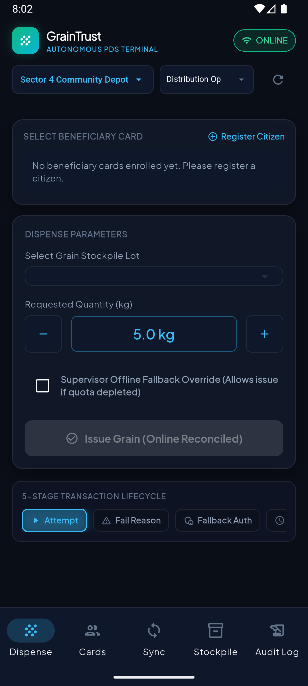
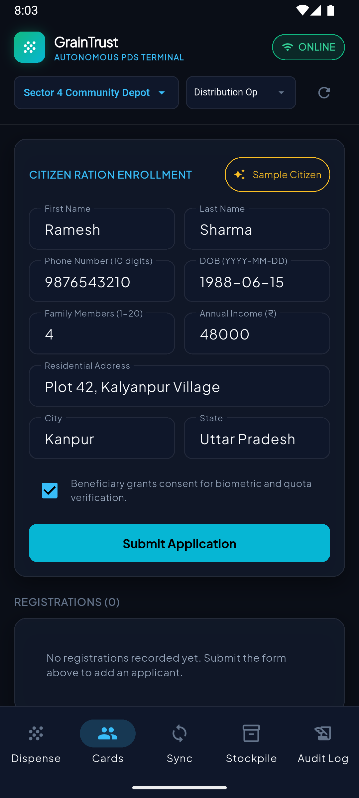
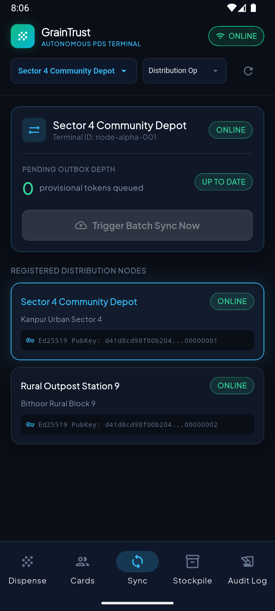
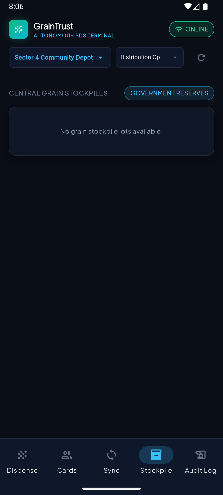
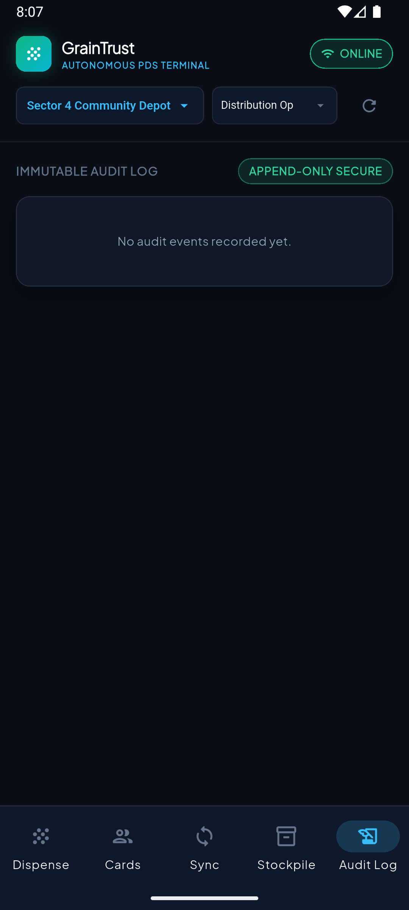
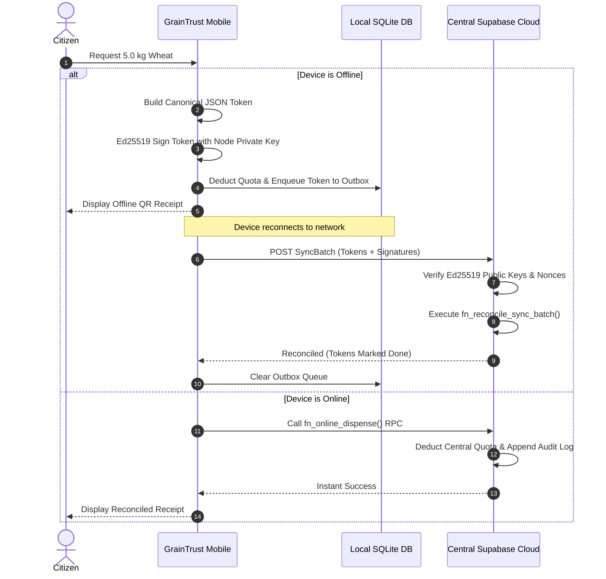

# 📱 GrainTrust Android Mobile Edge Terminal

[](LICENSE)
[](https://flutter.dev)
[](https://dart.dev)
[](https://developer.android.com)
[](https://supabase.com)
[](https://sqlite.org)

> **Autonomous Public Distribution System (PDS) Android Mobile Application**, built with **Flutter**, **SQLite**, **Ed25519 Canonical Cryptographic Signing**, and **Supabase Realtime**. Designed for frontline depot operators to dispense rations, enroll citizens, and synchronize ledgers even in disconnected rural environments.

---

## 📸 Application Screenshots & Tab Walkthrough

| **Dispense Desk** | **Citizen Enrollment** | **Edge Outbox & Sync** |
|:---:|:---:|:---:|
|  |  |  |

| **Warehouse Stockpiles** | **Immutable Audit Log** |
|:---:|:---:|
|  |  |

---

## 🌟 Deep Functional Walkthrough

### 1. Grain Dispense Desk (`DispenseTab`)
- **Beneficiary Card Selection**: Select from registered household ration cards. The UI displays card status (`ACTIVE`), household head name, and a visual progress gauge indicating remaining monthly quota (e.g., $15.0\text{ kg} / 20.0\text{ kg}$).
- **Stockpile Lot Selection**: Filter available grain lots (Wheat, Rice, Coarse Grains) allocated to the current depot node.
- **Precision Quantity Stepper**: Adjust dispense quantity in increments using smooth `-` and `+` steppers with electric-blue readout and min/max clamp protection.
- **Supervisor Offline Fallback Override**: Emergency toggle permitting ration release if biometric scanner verification fails or network connectivity times out.
- **5-Stage Transaction Lifecycle**: Visual stepper displaying real-time execution state:
  $$\text{ATTEMPT} \longrightarrow \text{FAIL\_REASON} \longrightarrow \text{FALLBACK\_AUTH} \longrightarrow \text{PROVISIONAL} \longrightarrow \text{RECONCILED}$$
- **Interactive QR Code Dialog**: Generates an instant high-resolution QR receipt containing the cryptographically signed Ed25519 provisional token for the citizen to scan and preserve offline.

### 2. Citizen Ration Enrollment (`RegistrationTab`)
- **Demographic Intake**: Form fields for First Name, Last Name, 10-digit Phone, DOB (`YYYY-MM-DD`), Family Member Count ($1\text{--}20$), Annual Income, Residential Address, City, and State.
- **Sample Citizen Generator**: Amber-highlighted `✨ Sample Citizen` button instantly pre-fills authentic KYC test data for high-speed field demonstration.
- **Biometric & Quota Consent**: Mandatory legal compliance checkbox before enrollment submission.
- **Automated Card Issuance**: Successful registration automatically derives household quota ($5\text{ kg} \times \text{members}$) and creates an active ration card.

### 3. Edge Outbox & Terminal Sync (`EdgeSyncTab`)
- **Outbox Queue Depth**: Real-time counter badge showing the number of locally signed provisional tokens waiting to be synchronized to the central cloud database.
- **Status Pills**: Dynamic indicators displaying `ONLINE`, `OFFLINE`, and `UP TO DATE` statuses.
- **One-Tap Batch Reconciliation**: `Trigger Batch Sync Now` button dispatches all queued SQLite transactions to Supabase RPC `fn_reconcile_sync_batch()`.
- **Registered Nodes Registry**: Displays connected depots (`Sector 4 Community Depot`, `Rural Outpost Station 9`) with their verified Ed25519 public key fingerprints.

### 4. Central Grain Stockpiles (`InventoryTab`)
- **Reserve Monitoring**: Live inventory tracking of national and regional grain silos (Sharbati Wheat, Sona Masoori Rice).
- **Depot Allocation Caps**: Enforces local grant limits so depot operators cannot dispense beyond their authorized physical stockpile.

### 5. Immutable Audit Log (`AuditLogTab`)
- **Append-Only Timeline**: Cryptographically ordered event feed capturing all distribution actions, operator logins, supervisor overrides, and sync reconciliations.
- **Event Inspection**: Tap any entry to inspect raw transaction JSON, Ed25519 digital signatures, and cryptographic nonces.

### 6. Universal Top Navbar & Terminal Controls
- **Depot Selector**: Instantly switch between authorized terminal nodes (`node-alpha-001` vs `node-beta-002`).
- **Role Switcher**: Switch active security context between `Distribution Op`, `Registration Op`, `Supervisor`, `Auditor`, and `Admin`.
- **Online/Offline Mode Toggle**: Tap the emerald `ONLINE` pill to simulate network disconnection (turns into red `OFFLINE` pill) and test autonomous edge operation.
- **Ledger Reset**: Quick-reset dialog to wipe test outboxes and re-seed clean demonstration state.

---

## 🔒 Cryptographic Offline Engine



---

## 🛠️ Prerequisites & Installation Guide

### 1. System Requirements
- **Flutter SDK**: `>= 3.13.5` (Compatible with Dart 3.13+)
- **Java Development Kit**: OpenJDK 17 (Eclipse Temurin recommended)
- **Android SDK**: Platforms 34/35/36, Build-Tools 34.0.0+, CMake 3.22.1, and NDK 28.2+
- **Physical Device or Android Emulator**: AVD with Android 14+ (API 34)

### 2. Configure Environment Variables
Ensure Flutter and Java are on your system `PATH`:
```bash
# Verify toolchain health
flutter doctor
```
All checks (Flutter, Android toolchain, Chrome, Visual Studio) should pass cleanly.

### 3. Clone Repository & Install Packages
```bash
git clone https://github.com/unknownYT500/rationsafe_mobile_app.git
cd rationsafe_mobile_app
flutter pub get
```

### 4. Run Static Code Analysis
Verify that the codebase has zero warnings and zero errors:
```bash
flutter analyze
# Output: No issues found!
```

### 5. Run the Mobile App on Emulator / Device

#### Method A: Direct Development Run (with Local Fallback)
```bash
flutter run
```

#### Method B: Run with Custom Supabase Cloud Credentials
Pass your Supabase project URL and client key directly at compile-time:
```bash
flutter run \
  --dart-define=SUPABASE_URL=https://<your-project-ref>.supabase.co \
  --dart-define=SUPABASE_KEY=<your-supabase-api-key>
```

#### Method C: Android Emulator Localhost Port Forwarding
If connecting to a backend or Supabase instance running locally on your host computer:
```bash
# In your host terminal:
adb reverse tcp:3001 tcp:3001
adb reverse tcp:54321 tcp:54321
```
*This allows the Android emulator to access `http://localhost:3001` and `http://localhost:54321` as if they were running directly on the device.*

---

## 🏗️ Building Standalone Android APKs

### Debug APK (for Testing)
```bash
flutter build apk --debug
# Output: build/app/outputs/flutter-apk/app-debug.apk
```

### Release APK (for Production Deployment)
```bash
flutter build apk --release
# Output: build/app/outputs/flutter-apk/app-release.apk
```

### Install Directly to Connected Device
```bash
adb install -r build/app/outputs/flutter-apk/app-debug.apk
```

---

## 📦 Publishing as an Independent GitHub Repository

```bash
git init
git add .
git commit -m "feat: initial commit for GrainTrust Mobile Application"
git remote add origin https://github.com/unknownYT500/rationsafe_mobile_app.git
git push -u origin main
```
